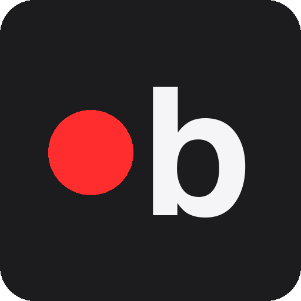

# broll

Busque vídeos **e imagens** gratuitos (Pexels + Pixabay + Wikimedia Commons), arraste direto pra dentro do editor — e até gere clipes de 5 segundos a partir das fotos. Simples assim.

<p>
  <a href="https://github.com/Saimonsanbr/broll/releases/latest"></a>
  &nbsp;
  <a href="https://github.com/Saimonsanbr/broll/releases/latest"></a>
</p>

> Projeto amador, feito pra uso pessoal, sem fins comerciais. Os botões acima levam sempre pra última versão. Linux também tem build (.AppImage/.deb) na página de releases.

## O que há de novo na 0.2.0

- **Imagens, não só vídeos** — Pexels fotos, Pixabay e Wikimedia Commons no mesmo grid, com o mesmo fluxo: passa o mouse pra ver maior, 1 clique baixa, arrasta o verde pro editor.
- **Seletor de modo** — `ambos (vídeos e fotos)` → `imagens` → `vídeos`, embaixo da pesquisa e na barra de cima. Funciona como filtro nos resultados já carregados; buscar de novo no modo vazio traz o outro tipo.
- **Crédito automático do Commons** — imagem que exige atribuição (CC BY, CC BY-SA…) já baixa com o crédito embutido no topo, discreto, com a fonte Poppins. CC0 e domínio público baixam limpas. Pexels e Pixabay nunca levam crédito (a licença não exige). Licença suspeita (NC, ND, desconhecida) nem aparece no grid.
- **Arquivo de segurança** — cada imagem do Commons com crédito guarda uma cópia leve + um `.txt` com autor, licença e links em `BROLL_CACHE/.originals` (o “Limpar cache” não apaga essa pasta).
- **Imagem → vídeo** — botão direito na imagem pronta abre o gerador: composição única ou duplicada (com fundo blur/escuro), animação (zoom in/out, pan cima/baixo), filtro (granulado, vinheta, fade) e tamanho do crédito. Sai sempre **1920×1080, 5s, sem áudio** em `Movies/broll-img2vid`, com a pasta abrindo sozinha. O crédito (quando exigido) vai estático no topo do vídeo.
- **Ícone de tipo** — todo card mostra se é vídeo ou imagem no canto superior esquerdo.
- **Bugs corrigidos** — scroll do Mac que morria depois de um tempo e card “pronto” que travava o arrasto.
- **Problema conhecido** — o zoom do gerador ainda tem uma tremidinha aqui e acolá; quase imperceptível, e será refinado nas próximas versões.

## Como funciona

Você pesquisa um termo, passa o mouse pra ver a prévia, clica uma vez pra baixar e arrasta o arquivo pronto pra dentro do editor (testado no CapCut, vale pra qualquer editor que aceite drop de arquivo).

- **Vídeos:** Pexels (API oficial com chave, ou modo web sem chave) + Pixabay (precisa de chave).
- **Imagens:** Pexels fotos + Pixabay + Wikimedia Commons (sem chave, com filtro de licença).
- O modo web do Pexels existe porque a Pexels **pausou a emissão de chaves novas** — sem chave, o app consulta o endpoint interno do próprio site, com pausas anti-bloqueio. Se um dia você conseguir uma chave oficial, é só colar nas configurações.

## Instalando

O app **não é assinado** (não temos certificado pago de desenvolvedor), então Mac e Windows reclamam na primeira abertura. É normal e seguro — o código é aberto e está todo aqui no repo.

### macOS (Apple Silicon e Intel)

1. Baixe o `.dmg` certo: com `-arm64` no nome = Apple Silicon (M1/M2/...); sem `-arm64` = Intel.
2. Abra o `.dmg` e arraste o **broll** pra pasta **Aplicativos**.
3. Na primeira abertura o macOS vai bloquear ("não foi possível verificar o desenvolvedor"). Pra liberar, abra o Terminal e rode:

```bash
xattr -cr /Applications/broll.app
```

4. Abra o app normalmente (se ainda reclamar, clique com o botão direito no app → Abrir → Abrir).

O `xattr -cr` só remove o selo de quarentena que o macOS coloca em tudo que é baixado da internet — não mexe em nada no sistema.

### Windows

1. Baixe o `broll.Setup.X.Y.Z.exe` (instalador) ou o portable.
2. O SmartScreen vai avisar que é de um editor desconhecido: clique em **Mais informações** → **Executar assim mesmo**.

### Linux

- **AppImage:** dê permissão e rode (`chmod +x broll-*.AppImage`); se faltar o FUSE: `sudo apt install libfuse2`.
- **.deb (Debian/Ubuntu):** dois cliques no arquivo ou `sudo dpkg -i broll_*_amd64.deb`.

## Rodando o código

Precisa do [Node 22](https://nodejs.org/).

```bash
npm install
npm run dev:electron
```

A chave do **Pixabay** é grátis (pegue em [pixabay.com/api/docs](https://pixabay.com/api/docs/)). A chave do **Pexels** é opcional — sem ela o app usa o modo web. Cole as chaves na engrenagem do app → Salvar → Testar as chaves.

Pra gerar vídeos a partir de imagem, o app usa o **ffmpeg** do sistema (e o **ImageMagick** só quando a imagem exige crédito). Nas configurações dá pra ver se foram detectados e informar caminhos customizados.

## Posso usar no YouTube? (segurança de licença)

Resposta curta: **sim, pode.**

- **Pexels e Pixabay:** [licença Pexels](https://www.pexels.com/license/) e [licença de conteúdo Pixabay](https://pixabay.com/service/terms/) liberam uso gratuito comercial e não-comercial **sem atribuição obrigatória**. O crédito que aparece no app é exigência das APIs, não do seu vídeo.
- **Wikimedia Commons:** cada arquivo tem sua licença. O app só mostra arquivos de licença livre e **aplica o crédito sozinho** quando a licença exige (CC BY, CC BY-SA…). Arquivo de domínio público/CC0 baixa limpo. A cópia leve + `.txt` em `.originals` serve de comprovante. Atenção: obra derivada de CC BY-SA (como o vídeo gerado) carrega a mesma exigência — o app registra isso no `.license.txt` ao lado do vídeo.
- **Ressalvas que valem pra tudo:** evite b-roll com pessoa reconhecível em contexto ofensivo/sensível ou marca/logo em destaque em vídeo comercial — nesses casos a licença joga a responsabilidade pra você.

## Logs do app

Tudo que o app faz é registrado num arquivinho de log por dia (pasta de dados do app, mantém os últimos 7 dias) — busca, downloads, arrastos, filtros e erros. Nas configurações, o botão **Mostrar logs** (por último, lá embaixo) exibe o que rolou desde que o app foi aberto. Útil pra diagnosticar qualquer problema sem precisar de terminal.

## Licenças

- **Código do app:** [MIT](LICENSE) — pode usar, copiar e modificar à vontade.
- **Mídia:** continua pertencendo aos autores e às plataformas. O app mostra o autor em cada card com link pra página original.
- **Fonte Poppins** (embutida, usada no crédito): [OFL 1.1](https://scripts.sil.org/OFL).
